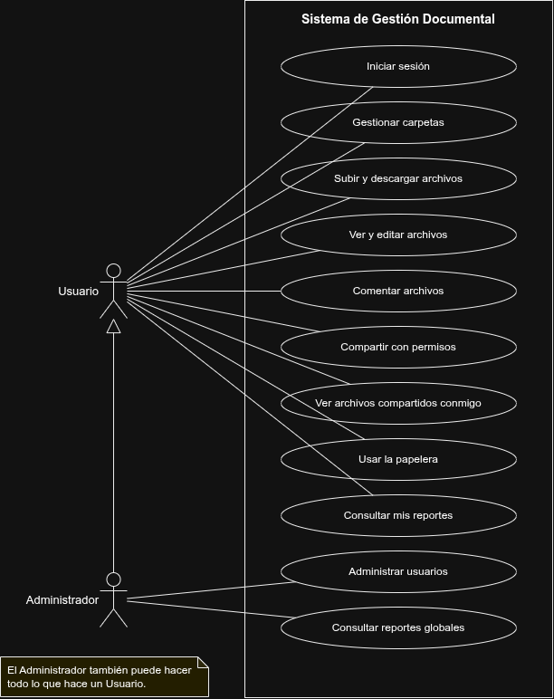
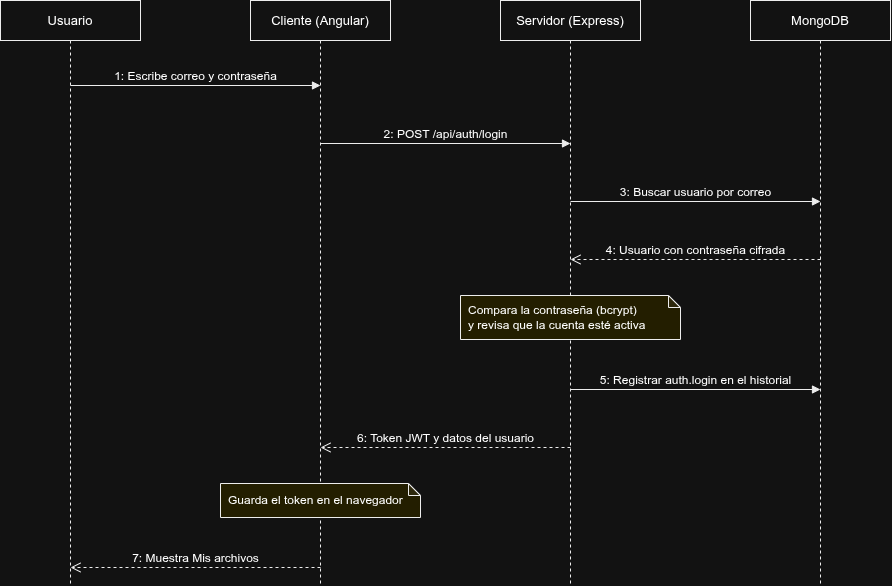
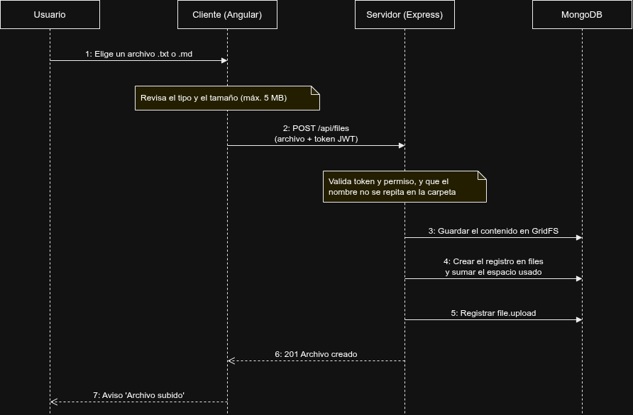
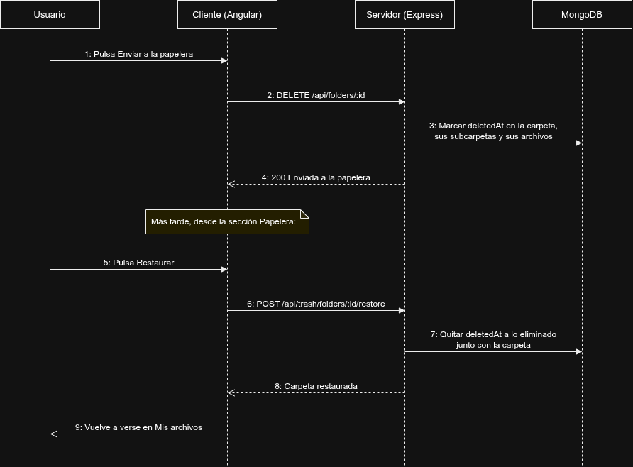
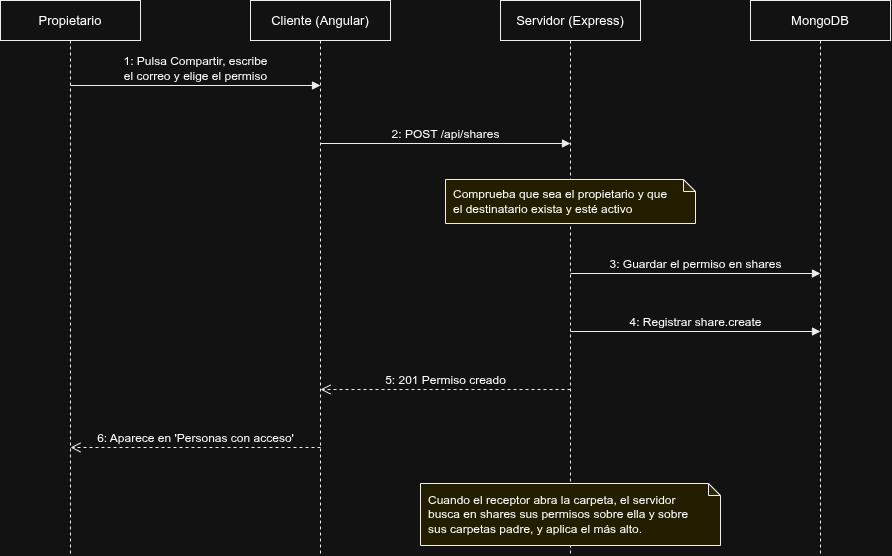
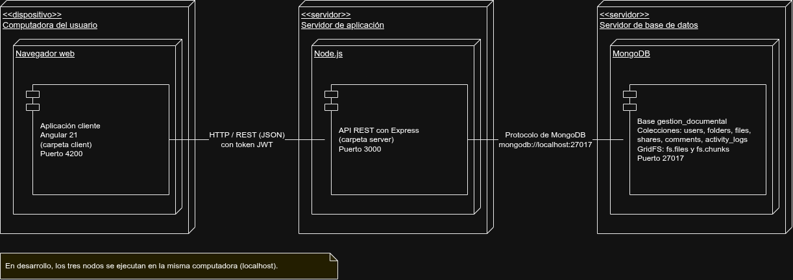

# Sistema de Gestion Documental

## Descripcion

Sistema de gestion documental desarrollado como Proyecto 2 del curso Manejo e Implementacion de Archivos, para una organizacion que necesita centralizar, organizar y compartir sus documentos digitales (archivos .txt y .md). El sistema permite almacenar archivos en carpetas, compartirlos con otros usuarios mediante permisos, recuperar lo eliminado desde una papelera y consultar reportes de uso, mediante una arquitectura cliente-servidor.

La aplicacion cliente esta desarrollada en Angular 21 y la aplicacion servidor en Node.js con Express, comunicandose mediante una API REST. Unicamente el servidor tiene acceso a la base de datos, la cual se administra en MongoDB y se inicializa con los scripts de la carpeta `database`. El contenido de los archivos se almacena en GridFS.

## Caracteristicas

- Arquitectura cliente-servidor con aplicaciones independientes (Angular 21 y Node.js con Express)
- Autenticacion mediante JSON Web Tokens (JWT) y contrasenas cifradas con bcrypt
- Control de acceso por roles (Administrador y Usuario) y por permisos sobre cada recurso
- Carpetas y subcarpetas con control de jerarquia: no se permiten ciclos ni referencias invalidas
- Contenido de los archivos almacenado en MongoDB mediante GridFS
- Compartir archivos y carpetas con permisos de lectura, comentario y edicion, heredados por el contenido de las carpetas
- Papelera con restauracion y eliminacion definitiva que mantienen la consistencia de carpetas y espacio usado
- Espacio de almacenamiento asignado, usado y disponible por usuario
- Historial de actividad de las principales operaciones realizadas
- Modulo de reportes con agregaciones de MongoDB, filtros por fecha, usuario y cantidad, y exportacion a CSV
- Validaciones de entrada: correo, nombres, contrasenas, identificadores, fechas, extensiones y tamano de archivo
- Los usuarios se desactivan sin perder su informacion historica

## Modulos del Sistema

### Modulo de Usuarios
Administracion de usuarios, roles, espacio asignado y activacion o desactivacion de cuentas, exclusivo del Administrador. Desactivar un usuario no elimina sus archivos ni su historial.

### Modulo de Carpetas y Archivos
Creacion, renombrado y movimiento de carpetas y subcarpetas. Carga, consulta, descarga, edicion, renombrado, movimiento y eliminacion de archivos .txt y .md, con busqueda por nombre, filtro por tipo y ordenamiento.

### Modulo de Comparticion y Comentarios
Compartir archivos y carpetas con otros usuarios, modificar o retirar los permisos concedidos y comentar los archivos cuando se tiene el permiso correspondiente.

### Modulo de Papelera
La eliminacion normal envia el recurso a la papelera. Desde ahi el propietario puede restaurarlo, eliminarlo de forma definitiva o vaciar la papelera.

### Modulo de Reportes e Historial
Reportes de archivos y almacenamiento, usuarios, comparticion y actividad, con filtros propios, barras comparativas y exportacion a CSV.

## Requisitos Previos

- **Node.js:** version 20.19 o superior (se recomienda la version 22)
- **MongoDB:** instancia local en `localhost:27017`
- **Angular CLI:** version 21
- **Sistema Operativo:** Windows, Linux o macOS

### Verificar las versiones instaladas

```bash
node -v
mongod --version
ng version
```

## Instalacion y Ejecucion

### 1. Clonar el repositorio

```bash
git clone https://github.com/Mynor-M-50/Proyecto_2_Manejo_De_Archivos_Mynor_Monzon_2S_2026.git
cd Proyecto_2_Manejo_De_Archivos_Mynor_Monzon_2S_2026
```

### 2. Configurar e iniciar el servidor (backend)

```bash
cd server
npm install
cp .env.example .env
```

Se debe editar el archivo `.env` y cambiar `JWT_SECRET` por un valor propio. Las demas variables (`MONGO_URI`, `DB_NAME`, `DEFAULT_QUOTA_MB`, etc.) tienen valores por defecto.

```bash
npm start
```

El servidor queda disponible en `http://localhost:3000` cuando la consola muestra `Servidor escuchando`.

### 3. Crear indices y cargar los datos iniciales

En otra terminal:

```bash
cd database
npm install
node indexes.js
node seed.js
```

`seed.js` borra los datos existentes de la base y vuelve a cargar la informacion inicial.

### 4. Iniciar la aplicacion cliente (frontend)

En otra terminal:

```bash
cd client
npm install
ng serve
```

### 5. Acceder al sistema

Con ambas aplicaciones en ejecucion, se abre el navegador en `http://localhost:4200`. La carga inicial incluye:

| Usuario | Contrasena | Rol |
|---|---|---|
| admin@gestion.com | Admin123* | Administrador |
| ana@gestion.com | User123* | Usuario |
| luis@gestion.com | User123* | Usuario |

La carga inicial contiene 3 usuarios, 14 carpetas (2 en la papelera), 50 archivos (7 en la papelera), 33 comparticiones, comentarios y 293 registros de historial.

## Estructura del Repositorio

```
Proyecto_2_Manejo_De_Archivos_Mynor_Monzon_2S_2026/
  server/                       -> Aplicacion servidor (Node.js + Express)
    src/
      config/                   -> Variables de entorno y conexion a MongoDB
      controllers/              -> Controladores de cada modulo
      middlewares/              -> Autenticacion, roles y manejo de errores
      models/                   -> Esquemas de Mongoose
      routes/                   -> Rutas de la API REST
      services/                 -> Reglas de negocio, permisos, GridFS y reportes
      utils/                    -> Validaciones, fechas y serializadores
  client/                       -> Aplicacion cliente (Angular)
    src/app/
      core/                     -> Modelos, servicios, guards e interceptores
      features/                 -> Una carpeta por pantalla
      layout/                   -> Menu lateral
      shared/                   -> Componentes y funciones reutilizables
  database/                     -> Scripts de indices y carga inicial (MongoDB)
  docs/                         -> Manuales, modelo documental y diagramas
```

## Tecnologias Utilizadas

| Tecnologia | Uso |
|---|---|
| Node.js 22 | Entorno de ejecucion del servidor |
| Express 5 | Framework del servidor y API REST |
| MongoDB | Base de datos NoSQL orientada a documentos |
| GridFS | Almacenamiento del contenido de los archivos en MongoDB |
| Mongoose 9 | Modelado y acceso a los datos |
| JWT (jsonwebtoken) y bcryptjs | Autenticacion y cifrado de contrasenas |
| multer | Recepcion de archivos subidos |
| Angular 21 | Framework del cliente |
| TypeScript | Lenguaje del cliente |
| draw.io | Diagramas UML |

## Autor

Mynor Miguel Monzon Martinez - 202230884

Universidad de San Carlos de Guatemala, Centro Universitario de Occidente (CUNOC)

---

## Documentacion

- [Manual de Usuario](docs/Manual_Usuario_Proyecto_2.pdf)
- [Manual Tecnico](docs/Manual_Tecnico_Proyecto_2.pdf)
- [Modelo Documental](docs/modelo-documental.md)

## Diagrama de Casos de Uso (UML)



## Diagrama de Secuencia: Iniciar Sesion (UML)



## Diagrama de Secuencia: Subir un Archivo (UML)



## Diagrama de Secuencia: Papelera (UML)



## Diagrama de Secuencia: Compartir una Carpeta (UML)



## Diagrama de Despliegue (UML)


